

  

  <a href="https://www.linkedin.com/in/kiran-d-9605772a4/" title="Open my LinkedIn profile">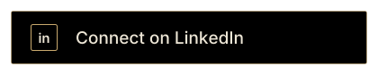</a>

<h3 align="center">At NXL Technologies</h3>

  
  

<h3 align="center">AI projects</h3>

  <a href="https://github.com/ultimate-kiran/airsaathi-smog-assistant" title="Open AirSaathi on GitHub"></a>
  <a href="https://github.com/ultimate-kiran/Intelligent_Data_Extraction_Pipeline" title="Open Intelligent Data Extraction Pipeline on GitHub"></a>

  <a href="https://github.com/ultimate-kiran/Medical_Knowledge_Assistant" title="Open Medical Knowledge Assistant on GitHub"></a>
  <a href="https://github.com/ultimate-kiran/Multi_agent_document_processor" title="Open Multi-Agent Document Processor on GitHub"></a>

<picture></picture>

 

  <a href="https://github.com/ultimate-kiran/image_and_prompt_to_image_generator_ai_project" title="Open AI Image Redesign Studio on GitHub"></a>
  <a href="https://github.com/ultimate-kiran/pdf_chatbot" title="Open PDF Chatbot on GitHub"></a>

  

<picture></picture>

 

  <a href="https://github.com/ultimate-kiran/bus_system" title="Open School Bus Transport System on GitHub"></a>
  <a href="https://github.com/ultimate-kiran/farm-management" title="Open Organic Farm Portal on GitHub"></a>

  Also on GitHub: <a href="https://github.com/ultimate-kiran/Hospital-Management-using-flutter" title="Flutter app">Hospital Management</a> (Flutter) and <a href="https://github.com/ultimate-kiran/fitness_tracker_angular" title="Angular app">Fitness Tracker</a> (Angular)

  Try them live: <a href="https://airsaathi-smog-assistant.vercel.app" title="Open the AirSaathi live demo">AirSaathi</a> and <a href="https://farm-management-rose-iota.vercel.app" title="Open the farm portal live site">the farm portal</a>

  

  

<picture></picture>

 

Fixes I've sent to <a href="https://github.com/npm/cli" title="npm/cli on GitHub">npm/cli</a>, the package manager that ships with Node.js

| Pull request | What it fixes |
|---|---|
| [#10362](https://github.com/npm/cli/pull/10362 "Open pull request #10362") | `npm uninstall` reports nothing removed under `install-strategy=linked` |
| [#10353](https://github.com/npm/cli/pull/10353 "Open pull request #10353") | `npm ci` rejects patches after Git for Windows converts them to CRLF |
| [#10351](https://github.com/npm/cli/pull/10351 "Open pull request #10351") | `npx` can't run pnpm-style `%~dp0` shims on Windows |

  
  

  <picture>
    <source media="(prefers-color-scheme: dark)" srcset="https://raw.githubusercontent.com/ultimate-kiran/ultimate-kiran/output/github-snake-dark.svg" />
    <source media="(prefers-color-scheme: light)" srcset="https://raw.githubusercontent.com/ultimate-kiran/ultimate-kiran/output/github-snake.svg" />
    
  </picture>

