  

  

### Open-source work

Fixes I've sent to [npm/cli](https://github.com/npm/cli), the package manager that ships with Node.js:

| Pull request | What it fixes |
|---|---|
| [#10362](https://github.com/npm/cli/pull/10362) | `npm uninstall` and `--dry-run` report nothing removed under `install-strategy=linked` |
| [#10353](https://github.com/npm/cli/pull/10353) | `npm ci` rejects patches after Git for Windows converts them to CRLF |
| [#10351](https://github.com/npm/cli/pull/10351) | `npx` can't run pnpm-style `%~dp0` shims on Windows |

### Activity

  
  

  <picture>
    <source media="(prefers-color-scheme: dark)" srcset="https://raw.githubusercontent.com/ultimate-kiran/ultimate-kiran/output/github-snake-dark.svg" />
    <source media="(prefers-color-scheme: light)" srcset="https://raw.githubusercontent.com/ultimate-kiran/ultimate-kiran/output/github-snake.svg" />
    
  </picture>

